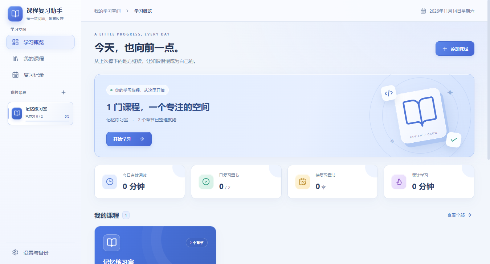
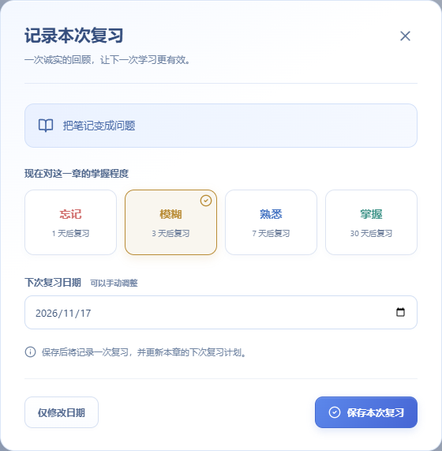

# Course Review Desk

[简体中文](README.md) · English

Turn local HTML lessons into a personal study library, resume where you left off, and schedule your next review.

**[Download for Windows x64](https://github.com/troulierkilian-blip/course-review-desk/releases/latest)** · Choose the `.exe` under **Assets**. The app interface and the bundled two-chapter course are in Simplified Chinese. Reading and review tracking work offline without an account.



## Try one review

1. Open the portable `.exe` and allow a moment for it to unpack.
2. On the home screen, select **开始学习** (Start learning) to open **记忆练习室** (Recall Lab). The first chapter asks you to remember the middle stop between a station and a clock tower. Try answering before you reveal the route.
3. Select **完成本次复习** (Finish this review). Pick **模糊** (Hazy) to revisit the chapter in three days, or edit **下次复习日期** (Next review date). Select **保存本次复习** (Save review).



From left to right, the suggested intervals are 1 day (Forgotten), 3 days (Hazy), 7 days (Familiar) and 30 days (Mastered). You can override the date for any rating.

## Bring your own HTML lessons

Open **我的课程 → 添加课程** (My courses → Add course) and choose an HTML file or a course folder. Keep images and stylesheets beside the lessons in their original folder structure. Check chapter order and resource warnings before importing. The app copies the course into your local library.

Reading position and checkboxes save automatically. Open **复习记录** (Review history) to see which chapters are due. Under **设置与备份** (Settings & backup), export or restore your courses and study records. The public build stores its library in `%APPDATA%\CourseReviewDeskPublic`.

## Optional AI companion

Under **设置与备份 → AI 服务**, enter a Chat Completions-compatible endpoint, model and your own API key. Save and test the connection. In the reader, open **AI 伴侣** or select text and right-click to ask a question. Drag the divider to resize the panel or double-click to reset it.

Opening the panel alone sends no request. When you ask a question, your chosen provider receives chapter text or excerpts, quoted material, your question and recent conversation from that chapter. Electron safeStorage encrypts the key locally. Backups exclude the key.

## Build from source

On Windows x64 with Node.js 24 LTS and npm, run the following at the repository root.

```powershell
npm ci
npx electron-builder install-app-deps
npm run typecheck
npm test
npm run build
npm start
```

Run `npm run pack` to create the portable EXE under `release/v1.2.1/`. The first build downloads Electron, native modules and packaging tools. The sample course is included. Run `npm run test:desktop` for import and restart checks, `npm run test:ai` for the local mock AI service, and `npm run test:portable` after packaging to verify the outer EXE. Tests use separate temporary libraries.

## License and support

The source code uses the [MIT license](LICENSE). The [sample course notice](bundled/recall-lab/NOTICE.txt) covers the bundled lessons. Imported materials and third-party dependencies retain their respective rights and licenses.

If the project helps you study, you can support it via Alipay or WeChat.

| Alipay | WeChat |
| :---: | :---: |
|  |  |
