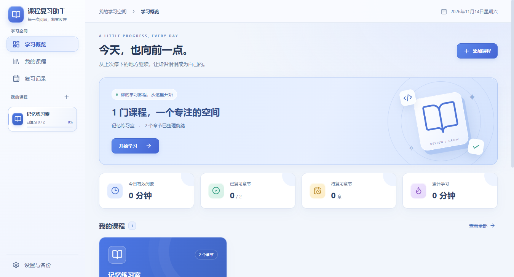
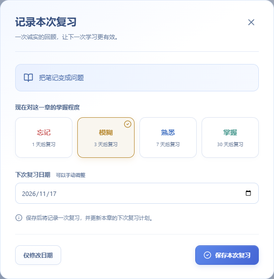

# 课程复习助手 · Course Review Desk

简体中文 · [English](README.en.md)

把散落在电脑里的 HTML 课件整理成书架，接着上次的位置阅读，再按掌握程度安排下次复习。

**[下载 Windows x64 免安装版](https://github.com/troulierkilian-blip/course-review-desk/releases/latest)** · 在发布页的 **Assets** 中选择 `.exe` 文件。阅读、勾选和复习记录均可离线使用，无需注册账号。

**[图文教程：如何把本地 HTML 课件做成离线复习书架？](docs/offline-html-study-guide.md)** 跟着「条件概率」一章导入课件、安排下次复习，也可以接入自己的 AI 助手，选中公式直接提问。



## 用三步体验一次间隔复习

1. 双击下载的 `.exe`，等待运行组件解包。
2. 在首页点 **开始学习**，打开内置的《记忆练习室》。第一章「把笔记变成问题」请你回想从车站到钟楼，中途经过哪里。先试着回答，再展开参考答案。
3. 点 **完成本次复习**。如果刚才没记清中途那一站，选 **模糊**，软件会把下次复习安排在 3 天后。也可以手动调整 **下次复习日期**，最后点 **保存本次复习**。



四档默认间隔分别为「忘记」1 天、「模糊」3 天、「熟悉」7 天和「掌握」30 天。到期的章节可以在「复习记录」里找到。

## 导入自己的 HTML 课件

在 **我的课程 → 添加课程** 选择课程文件夹或单个 HTML 文件。保留图片、样式表等附件在原课程目录中的相对位置，检查章节顺序和资源提示后确认导入。软件会把资料复制到本机书架。

阅读位置和勾选状态会自动保存。在 **设置与备份** 可导出或恢复课程与记录。公开版使用独立的 `%APPDATA%\CourseReviewDeskPublic` 资料目录。

## 可选的 AI 伴侣

需要 AI 时，在 **设置与备份 → AI 服务** 填写兼容 Chat Completions 的基础地址、模型和自己的 API Key。保存并测试连接后，在阅读页点 **AI 伴侣**，或选中文字后右键提问。左右拖动分隔栏可调宽，双击复位。

打开面板本身不会发送请求。主动提问时，你选择的服务商会收到当前章节的文字或节选、引用、问题和近期本章对话。密钥由 Electron safeStorage 在本机加密，备份中不包含密钥。

## 从源码构建

使用 Windows x64、Node.js 24 LTS 和 npm。在仓库根目录执行：

```powershell
npm ci
npx electron-builder install-app-deps
npm run typecheck
npm test
npm run build
npm start
```

用 `npm run pack` 生成单文件 EXE，输出位于 `release/v1.2.1/`。首次构建需要联网下载 Electron、原生模块和打包工具。示例课程已包含在仓库内，无需另行取材。可通过 `npm run test:desktop` 测试导入与重启恢复，`npm run test:ai` 使用本机模拟接口；构建 EXE 后运行 `npm run test:portable` 验证外层文件。上述测试在独立临时资料库运行。

## 许可

软件源代码采用 [MIT](LICENSE)。[原创示例的授权](bundled/recall-lab/NOTICE.txt) 单独列明；使用者导入的课程和第三方依赖各自保留原有权利及许可。

## 支持项目

如果「课程复习助手」帮到了你，欢迎通过支付宝或微信扫码打赏。感谢你的支持！

| 支付宝 | 微信 |
| :---: | :---: |
|  |  |
