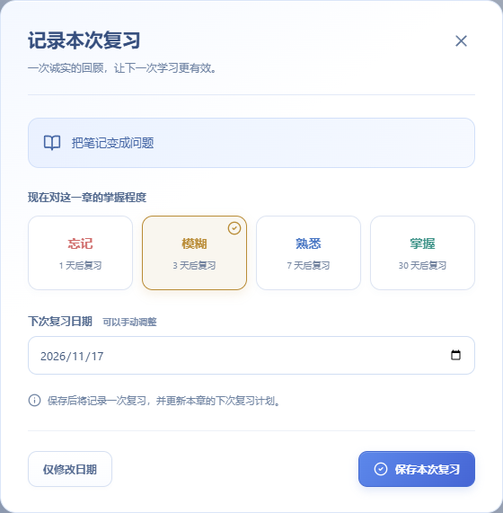

# 如何把本地 HTML 课件做成离线复习书架？在 Windows 上导入课件、保存进度、安排复习日期

一门课有十几个 HTML 文件，双击就能读。麻烦的是隔几天再打开：上次读到了哪一章？哪一节当时看懂了，合上课件却讲不出来？

下面用 Windows 版「课程复习助手」走一遍。假设你手里有一份《概率论》课件，今天读「条件概率」，想把没记牢的内容安排到三天后再看。导入、阅读和安排复习都可以离线完成，无需注册账号。遇到看不懂的公式，还可以接入自己的 AI 服务，选中原文直接提问。

## 第一步：下载工具，选对要导入的文件

打开项目的发布页，在 **Assets** 里下载文件名以 `win-x64.exe` 结尾的免安装版。双击运行，第一次打开时等它解包。[课程复习助手 GitHub 仓库](https://github.com/troulierkilian-blip/course-review-desk) · [最新版下载页](https://github.com/troulierkilian-blip/course-review-desk/releases/latest)

进入 **我的课程 → 添加课程**，按手上的资料选入口：

- **只有一个独立的网页文件**，例如 `条件概率.html`：点 **选择 HTML 文件**。
- **有多章课件，或者 HTML 旁边还有图片、样式文件夹**：点 **选择课程文件夹**。比如 `概率论` 文件夹里放着 `index.html`、各章网页和 `images`，就选整个 `概率论` 文件夹，保留原来的目录结构。

在 **确认导入内容** 窗口核对章节名称、顺序和资源提示，点 **确认导入**。回到「我的课程」，打开刚导入的课，再点要读的章节。软件会把资料复制到本机书架；以后从书架打开就行。

## 第二步：读完一章，选「模糊」，看看日期怎么变

读完「条件概率」，先把目光移开，试着回答一句：**算 P(A｜B) 时，分母用 P(A) 还是 P(B)？** 如果你认得公式，却要翻回去才能确定分母是 P(B)，这次就可以选「模糊」。

在阅读页点 **完成本次复习 → 模糊**，看窗口里的 **下次复习日期**。例如 11 月 14 日做这次复习，选「模糊」后，日期会变成 **11 月 17 日**。如果 16 日就要考试，可以直接把日期改成 15 日。确认后点 **保存本次复习**。

四个选项的默认间隔依次是「忘记」1 天、「模糊」3 天、「熟悉」7 天、「掌握」30 天。手头暂时没有自己的课件，也可以打开软件自带的 **《记忆练习室》**，用第一章试一次上图的操作。

## 第三步：确认这章已经排进复习计划

保存后，阅读页底部会显示这章的**下次复习日期**。打开左侧 **复习记录**，在复习历史中找到刚读的章节，可以看到本次掌握程度和「安排至」的日期。

如果你安排的是三天后，今天的 **到期复习** 列表里还看不到它，这是正常的。到约定日期再打开软件，这章就会出现在到期列表里。点进去，先回答上次卡住的那个问题，再决定下一次隔多久复习。

## 可选：如何接入 AI 助手，选中 HTML 课件里的公式提问？

假设三天后再读「条件概率」，你已经记住分母是 P(B)，却说不清为什么。可以让 **AI 复习伴侣** 结合这一章举个例子，再出一道题让你自己算。

1. 打开左侧 **设置与备份**，找到 **AI 服务**。从你使用的 AI 服务商控制台复制三项信息，分别填入 **API 基础地址**、**模型名称** 和 **API Key**。接口需要兼容 Chat Completions，基础地址和模型名称都按服务商给出的值填写。
2. 点 **保存设置 → 测试连接**。看到「连接成功，模型已返回文字回答」后，回到「条件概率」章节。用鼠标选中公式或旁边的一句解释，右键点 **询问 AI**。
3. 在打开的面板里确认引用的是你想问的那句话，输入下面的问题，再点 **发送问题**。

> 掷一枚公平的六面骰子。已知点数是偶数，为什么算“点数大于 3”的概率时，只看 2、4、6？请把这三个数和公式里的 P(B) 联系起来，再给我一道类似的题，先别给答案。

看完解释，合上课件试着复述：“已知是偶数，可能的点数就只剩 2、4、6，其中 4 和 6 大于 3，所以概率是 2/3。”再自己做那道练习，根据能否独立算出来，回到 **完成本次复习** 选择掌握程度。

**哪些内容会发给服务商？** 测试连接会发送一条简短的测试消息。主动提问时，助手会把你的问题、所选原文、课程和章节名称、本章文字（较长时取节选），以及本章近期对话一并发给你配置的服务商。API Key 加密保存在本机，导出的资料备份不含密钥。

## 两个容易卡住的地方

**导入后文字能看，图片却不显示，怎么办？** 先用浏览器打开原来的 HTML，确认原文件能显示图片。如果图片原本放在旁边的 `images` 文件夹里，导入时选包含网页和图片的共同上级文件夹。只把 HTML 单独拷出来，会让原来的相对路径找不到图片。

**上次读到的位置还在，为什么没有复习记录？** 阅读位置和勾选状态会自动保存。要把这次学习记入复习历史，还需要点 **完成本次复习 → 保存本次复习**。如果只是给已有计划改期，点 **仅修改日期**，复习次数会保持原值。
